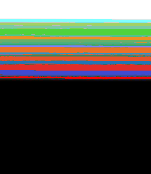
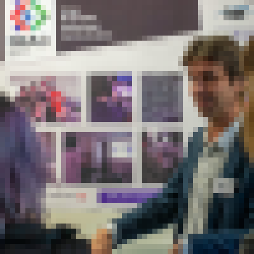

**Rapport**

Le lien vers le [repo Git](https://github.com/CamRhod/Workshop.cpp1.git)

**Ex1: Que du Vert**
Au départ j’ai utilisé un produit en croix pour travailler avec le RGB codé sur 8bits mais ça n’a pas fonctionné.

Inline-style:

**Ex2: Switch**

**Ex3: Monochrome**

J’ai eu des soucis parce qu’à la ligne 12 j’avais écrit “int grey” à la place de “float grey”.

**Ex4: Négatif**

**Ex5: Dégradée**

**Ex6: Mirroir**

J’ai eu un problème car dans mon code j’avais une erreur “out of range”. Par tâtonnement, j’ai résolu le problème.

Un autre type de mirroir que j'ai obtenu durant l'avancé du programme.

**Ex7: Bruitée** 

**Ex8: 90°**

Au départ j'ai eu le résultat ci-dessous.

**Ex9:RGB Split**
L'effet fonctionne mais les couleurs sont un peu mangéessur la largeur.

**Ex10: Luminosité**

**Ex11**

**Ex12**

**Ex13**

**Ex14**

Beaucoup de difficulté, notamment dans l’utilisation de la trigonométrie dans le code.

**Ex15**

**Ex16**

**Ex17**

**Ex18**

**Autre01**

L'année dernère on avait fait un programme python qui pixelisait les images. Donc j'ai voulu reproduire ce programme en cpp.

