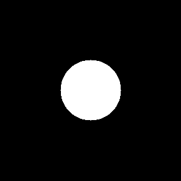
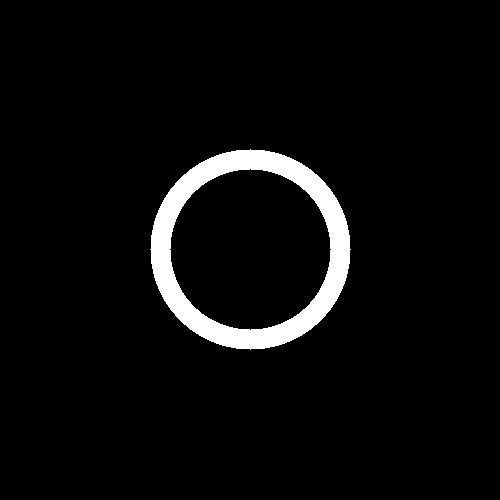
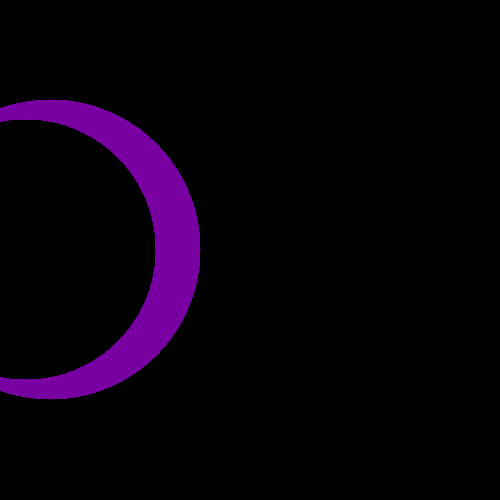
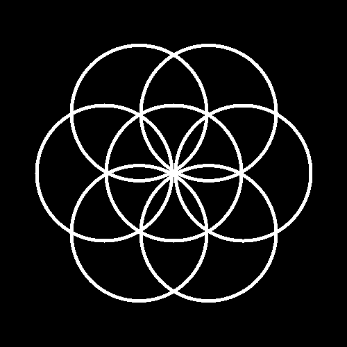
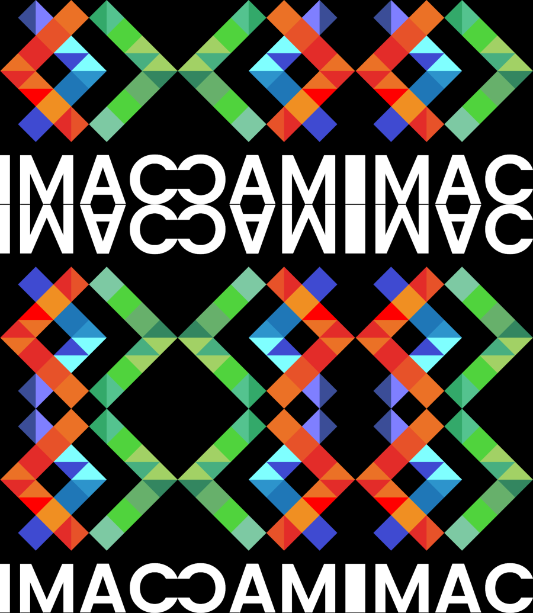

**Rapport**

Le lien vers le [repo Git](https://github.com/CamRhod/Workshop.cpp1.git)

**Ex1: Que du Vert**
Au départ j’ai utilisé un produit en croix pour travailler avec le RGB codé sur 8bits mais ça n’a pas fonctionné.

**Ex2: Switch**

**Ex3: Monochrome**

J’ai eu des soucis parce qu’à la ligne 12 j’avais écrit “int grey” à la place de “float grey”.

**Ex4: Négatif**

**Ex5: Dégradée**

**Ex6: Mirroir**

J’ai eu un problème car dans mon code j’avais une erreur “out of range”. Par tâtonnement, j’ai résolu le problème.

Un autre type de mirroir que j'ai obtenu durant l'avancé du programme.

**Ex7: Bruitée** 

**Ex8: 90°**

Au départ j'ai eu le résultat ci-dessous.

**Ex9:RGB Split**

L'effet fonctionne mais les couleurs sont un peu mangées sur la largeur.

J'ai par la suite réuissi à régler le problème.

**Ex10: Luminosité**

**Ex11: Disque**

**Ex12: Cercle**

Dans un premier temps, j'avais fait l'exercice en créant deux disque, un blanc et un autre noir plus petit. Par la suite j'ai optimisé le programme.

**Ex13: Animation**

**Ex14: Rosace**

Beaucoup de difficulté, notamment dans l’utilisation de la trigonométrie dans le code.

**Ex15: Mosaïque**

**Ex16: Mosaïque Mirroir**

**Ex17: Glitch**

**Ex18: Tri**

J'ai mis du temps a comprendre comment fonctionne "image.pixel()" et "glm::vec3".

**Mon Effet: Pixelisé**

L'année dernère on avait fait un programme python qui pixelisait les images. Donc j'ai voulu reproduire ce programme en cpp. Le programme que j'ai écrit ne s'applique qu'aux photos de la même dimension que celle utilisée.

